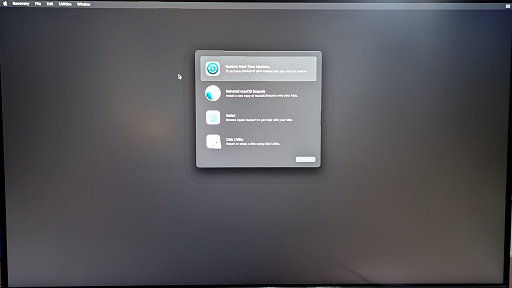

# 华硕 B460 黑苹果基准 EFI 01

<image src="../21.png" alt="华硕 B460M-PLUS 黑苹果基准版实机启动成功截图" />



> **状态：实机测试通过（用户反馈）**。此标记表示该 EFI 已在目标机器完成实际启动验证；并不表示所有外设、睡眠、电源管理或 macOS 更新场景均已覆盖。

## 1. 版本定位

- 发布名称：**华硕b460黑苹果基准efi01**
- 主板：ASUS TUF GAMING B460M-PLUS（非 Wi-Fi 版本）
- CPU：Intel Core i5-10500ES（用户提供）
- 显卡：AMD Radeon RX 570（用户提供）
- OpenCore：基准包所带版本；构建及配置校验使用 OpenCore 1.0.8 对应工具链
- macOS 目标：macOS Sequoia（本项目当前目标）
- EFI 角色：已实机验证的 VESA 显示诊断基准，用于后续键盘输入 A/B 测试的共同起点

## 2. 基准版的关键技术设置

- SMBIOS：iMac20,1
- 启动参数包含 `-radvesa` 与 `-wegnoigpu`；不使用 `-wegnoegpu`
- 显卡采用 VESA 诊断显示路径，暂不把 RX 570 的完整图形加速作为本基准的验收目标
- 保留基准包原有 ACPI、Kernel、Kexts、UEFI 驱动及 USB 映射（包含 UTBMap.kext）
- 不叠加同型号键盘参考参数，也不加载 OpenUsbKbDxe / Ps2KeyboardDxe
- 此版本是后续候选 EFI 的共同回退点；除非实验记录明确要求，不应直接在基准上混入多个变量

## 3. 已知硬件及验证边界

目标主板为 ASUS TUF GAMING B460M-PLUS，非 Wi-Fi 版；用户此前提供的 PCI 设备信息包含 Intel UHD 630 设备 ID `PCI\\VEN_8086&DEV_9BC8`。此基准通过 VESA 路径验证显示输出，不能据此认定 UHD 630 或 RX 570 的完整硬件加速已启用。

实机测试通过是用户反馈的结果。GitHub Actions 可验证 EFI 包完整性、配置结构和构建流程，但不能模拟真实主板固件、USB 键盘控制器或物理显示输出。

## 4. 基准 EFI 下载

- [下载 VESA 诊断基准 EFI ZIP](https://github.com/hf9syu5v-dev/game-accelerator/releases/download/b460m-rx570-vesa-diagnostic/B460M-RX570-VESA-Diagnostic-EFI.zip)
- [基准 EFI 发布记录](https://github.com/hf9syu5v-dev/game-accelerator/actions/runs/45831952465)
- [基准恢复脚本](https://github.com/hf9syu5v-dev/game-accelerator/blob/opencore-1.0.5-sequoia-rx570/B460M-OC-Builder/Restore-B460M-RX570-VESA-Keyboard-Baseline.ps1)

基准 ZIP SHA-256：

```
fda623c96ed4ea8370ad1e985a1a2f5ac7e9a651815c57e959bea0d28a026daf
```

## 5. 后续键盘实验顺序

1. **基准 EFI 01**：已实机测试通过，作为回退点。
2. **移植版 01**：从同型号 ASUS TUF GAMING B460M-PLUS（非 Wi-Fi）参考 EFI 仅移植键盘输入相关参数；保留基准的显卡、USB、ACPI、鼠标和其余设置。
3. **移植版 02**：关闭内置 KeySupport，关闭 PollAppleHotKeys，单独启用 OpenUsbKbDxe，作为互斥备用路线。该驱动在现代 UEFI 上并非推荐默认方案，仅用于受控 A/B 测试。
4. **移植版 03**：保持内置 KeySupport 开启、不加载 OpenUsbKbDxe，仅关闭 PollAppleHotKeys，单独验证 OpenCore 官方故障排查中的另一条内置输入路径。

每次只测试一个候选版本。若候选版启动异常，恢复本基准 EFI 后再进入下一项。

## 6. 自动化验证记录

- 基准恢复脚本安全边界与 PowerShell 静态检查：[Actions #45831952465](https://github.com/hf9syu5v-dev/game-accelerator/actions/runs/45831952465)
- 移植版 01 构建、配置和路径检查：[Actions #45832145730](https://github.com/hf9syu5v-dev/game-accelerator/actions/runs/45832145730)
- 移植版 01 部署脚本最新验证：[Actions #45832210882](https://github.com/hf9syu5v-dev/game-accelerator/actions/runs/45832210882)
- 移植版 02 构建、OpenCore 配置校验及发布步骤：[Actions #45832092434](https://github.com/hf9syu5v-dev/game-accelerator/actions/runs/45832092434)

## 7. 安全注意事项

- EFI 部署脚本只允许操作已核验身份的目标 USB EFI 分区；不应格式化 U 盘或改动 Recovery 分区、内部 SSD。
- 每次刷写前确认 U 盘盘符、型号、序列号和分区身份与脚本预期一致。
- SMBIOS 序列号、MLB、ROM、UUID 属于用户后续自行生成和替换的独立工作；本基准文档不公开任何真实设备身份值。
- 请保留每次部署前的 EFI 备份，并记录 Picker、Recovery、显示和鼠标的实际表现。
